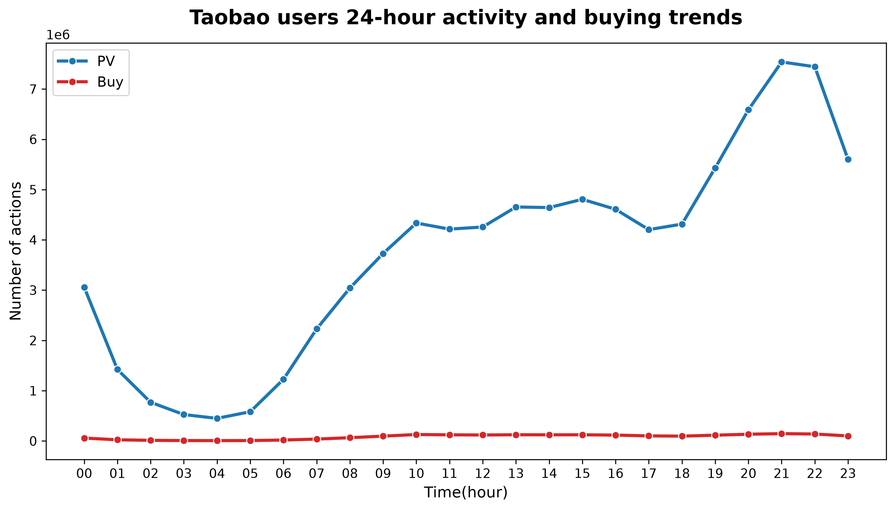
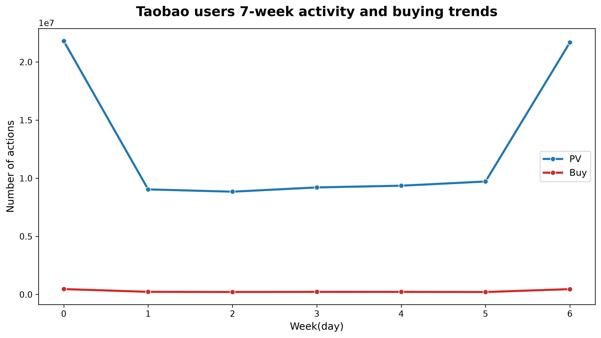
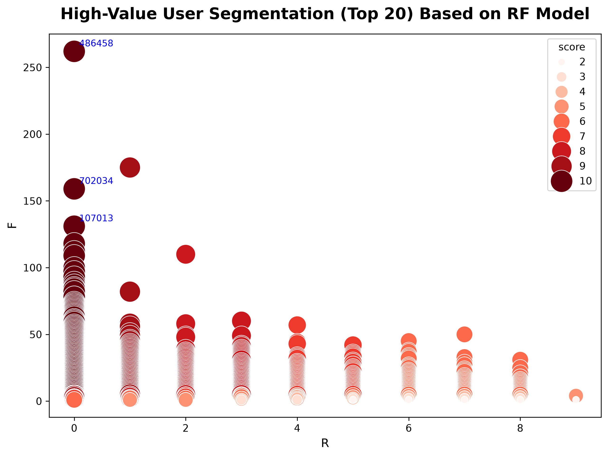
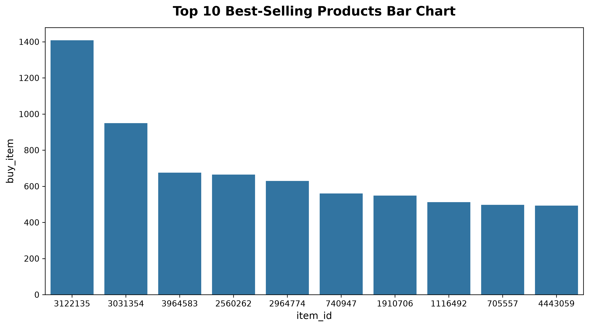
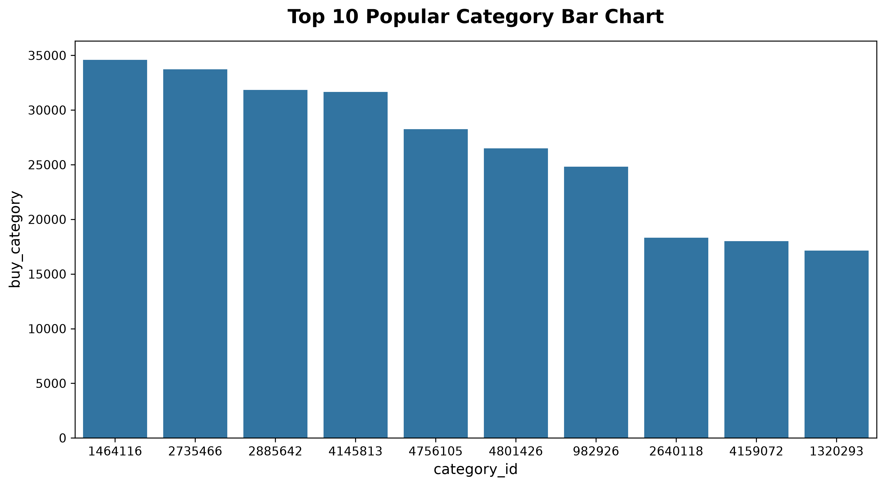

已获取仓库结构。为准确撰写 README，我需要细读每个源码文件的内容。现在读取各文件的原始内容。


我已通过仓库文件树与原始文件内容，逐一细读了该项目的所有文件（`table.py`、`analyse.py`、`visualize.py`、`.gitignore`、`README.md` 以及 `Data/` 目录下的 5 张图表文件），以下为基于实际代码重新撰写的 README，全部为 Markdown 格式：

---

# UB_F_TBB (User Behavior From Taobao Batch)

> 🚀 基于 **Python + SQLite** 的淘宝亿级用户行为数据离线分析项目 —— 经典 Hive 批处理项目 `UserBehaviorFromTaobao_Batch` 的轻量化复刻版。

## 📖 项目简介

本项目将经典大数据实战项目 **UserBehaviorFromTaobao_Batch**（原基于 Hive 离线批处理）迁移至纯 Python 生态：以 **SQLite** 作为存储与计算引擎，**pandas** 完成亿级 CSV 的分块导入，**Seaborn / Matplotlib** 产出统计图表，覆盖 **数据导入 → 数据清洗 → 指标分析 → 数据可视化** 的完整流程。

项目无需 Hadoop / Hive 等重型组件，单台个人电脑即可运行，适合用于：

- 学习 SQL 数据分析与电商核心指标（PV / UV、转化漏斗、复购率、RF 用户分层）；
- 理解大文件分块导入、任务幂等控制等工程实践；
- 作为后续高性能方案（如 Polars）重构的实验基线。

**处理流程总览：**

```text
UserBehavior.csv (约 1 亿行, ~3.5GB)
        │  table.py      分块导入(20万行/块) + 去重 + 时间过滤
        ▼
UserBehavior.db (SQLite)
        │  analyse.py    9 大指标分析，物化为中间结果表 (task_status 幂等控制)
        ▼
中间结果表 (metric_overview / conversion_rate / user_rf_top ...)
        │  visualize.py  Seaborn + Matplotlib 绘图
        ▼
5 张分析图表 (Data/*.png)
```

---

## ✨ 核心特性

- ✅ **分块导入**：`pd.read_csv(chunksize=200000)` + `to_sql(if_exists="append")` 逐块写入，避免一次性加载亿级数据导致内存溢出；
- ✅ **幂等任务控制**：自建 `task_status` 状态表记录每个任务的完成标记，重复运行脚本时自动跳过已完成步骤，避免重复计算；
- ✅ **数据清洗**：`SELECT DISTINCT` 重建表去除整行重复记录 + `DELETE` 过滤目标时间窗之外的异常数据；
- ✅ **指标丰富**：PV / UV、转化漏斗（三步）、复购率、小时级与星期级活跃分布、RF 用户价值分层、Top10 爆款商品与热门类目；
- ✅ **进阶 SQL 技巧**：条件聚合（`CASE WHEN`）、CTE（`WITH`）、窗口函数 `DENSE_RANK()` / `NTILE(5)`、日期函数 `JULIANDAY()` / `strftime()`；
- ✅ **可视化产出**：5 张 300 dpi 图表，已随仓库提交，可直接查看。

---

## 📊 数据集说明

- **数据来源**：阿里巴巴天池公开数据集 [UserBehavior（淘宝用户行为数据）](https://tianchi.aliyun.com/dataset/649)
- **时间跨度**：2017-11-25 ~ 2017-12-03（共 9 天，含两个完整周末）
- **数据规模**：约 1 亿条记录（原始 CSV 约 3.5 GB，无表头）

| 字段名 | 类型 | 描述 |
| :--- | :--- | :--- |
| `user_id` | TEXT | 用户 ID |
| `item_id` | TEXT | 商品 ID |
| `category_id` | TEXT | 商品类目 ID |
| `behavior_type` | TEXT | 行为类型枚举：`pv`(点击)、`fav`(收藏)、`cart`(加购)、`buy`(购买) |
| `timestamp` | INTEGER | 行为 Unix 时间戳 |
| `datetime` | TEXT | **派生列**，由 `timestamp` 格式化为 `YYYY-MM-DD HH:MM:SS`（本地时区） |

---

## 📁 项目结构

```text
UB_F_TBB/
├── Data/                                    # 数据与图表目录
│   ├── UserBehavior.csv                     # 原始数据集 (需自行下载, 已被 git 忽略)
│   ├── UserBehavior.db                      # SQLite 数据库 (运行后自动生成, 已被 git 忽略)
│   ├── 24_Hour_Activity_Trend.png           # 图表: 24 小时活跃趋势
│   ├── 7_week_Activity_Trend.png            # 图表: 一周 7 天活跃趋势
│   ├── RFM_User_Value_Segmentation.png      # 图表: RF 用户价值分层散点图
│   ├── Best_Selling_Products_Bar_Chart.png  # 图表: Top10 爆款商品柱状图
│   └── Popular_Category_Bar_Chart.png       # 图表: Top10 热门类目柱状图
├── table.py                                 # ① 数据导入、建表与清洗 (含任务状态管理)
├── analyse.py                               # ② 核心指标分析 SQL 与终端结果输出
├── visualize.py                             # ③ 数据可视化, 产出 5 张图表
├── .gitignore                               # 忽略 .venv/、*.db、*.csv
└── README.md                                # 项目说明文档
```

---

## 🧩 模块详解

### ① `table.py` —— 数据导入与清洗

运行方式：`python table.py`

1. **数据库探测**：若 `./Data/UserBehavior.db` 已存在则直接连接复用；否则创建 `user_behavior` 明细表；
2. **分块导入**：以 20 万行为一块读取 CSV（`header=None` 并按字段顺序命名），逐块 `to_sql` 追加写入，并打印每块处理进度；
3. **时间格式化**：导入完成后批量执行
   ```sql
   UPDATE user_behavior SET datetime = datetime(timestamp, 'unixepoch', 'localtime');
   ```
4. **任务状态表**：创建 `task_status(task_name TEXT PRIMARY KEY, is_done INTEGER NOT NULL DEFAULT 0)`，作为全流程的幂等标记中心；
5. **数据清洗**（标记 `user_behavior_clean`，仅执行一次）：
   - **去重**：`CREATE TABLE ... AS SELECT DISTINCT *` 重建明细表并 `DROP` / `RENAME`，去除整行重复记录；
   - **时间过滤**：`DELETE` 掉 `datetime` 不在 `2017-11-25 00:00:00 ~ 2017-12-03 23:59:59` 范围内的异常记录。

### ② `analyse.py` —— 核心指标分析

运行方式：`python analyse.py`（依赖 `table.py` 已生成的 `UserBehavior.db`）

每个分析模块遵循统一范式：**查询 `task_status` 标记 → 已完成则直接读取物化结果表；未完成则执行 `CREATE TABLE ... AS SELECT` 计算、落盘并登记标记**，保证幂等可重跑。

| # | 分析模块 | 结果表 | 任务标记 | 说明 |
| :-: | :--- | :--- | :--- | :--- |
| 1 | 流量与用户规模 | `metric_overview` | `metric_overview_sign` | 周期总访问量（`pv` 行为数）与独立访客数（`COUNT(DISTINCT user_id)`） |
| 2 | 用户行为聚合 | `user_behavior_count` | `user_behavior_count_sign` | 按用户聚合点击 / 收藏 / 加购 / 购买次数，构建用户画像宽表 |
| 3 | 复购率 | —（即时查询） | — | 购买次数 ≥ 2 的用户占全部购买用户的比例 |
| 4 | 转化漏斗 | `conversion_rate` | `conversion_rate_sign` | 第一步 / 第二步 / 总体转化率 |
| 5 | 日内活跃时段 | `behavior_hourly` | `behavior_hourly_sign` | 一天 24 小时内四种行为的分布（`strftime('%H')` 分组） |
| 6 | 周内活跃分布 | `behavior_weekly` | `behavior_weekly_sign` | 一周内各天行为分布；`strftime('%w')` 映射为星期名称（Monday~Sunday），并按自然周排序（周日置末） |
| 7 | RF 高价值用户 | `user_rf_top` | `user_rf_top_sign` | 基于购买行为的 R / F 打分，终端输出 Top 10 |
| 8 | Top10 爆款商品 | `top_items` | `top_items_sign` | 按商品聚合四种行为，购买量 `DESC` 取前 10 |
| 9 | Top10 热门类目 | `top_categories` | `top_categories_sign` | 按类目聚合四种行为，购买量 `DESC` 取前 10 |

**转化漏斗公式：**

- 第一步转化率 = `(fav + cart) / pv`
- 第二步转化率 = `buy / (fav + cart)`
- 总体转化率 = `buy / pv`

**RF 用户价值模型（仅基于 `buy` 行为，CTE 三层实现）：**

1. `CTE`：计算每个用户的 **R (Recency)** = 最后一次购买距基准日 `2017-12-04` 的天数（`JULIANDAY` 差值取整），**F (Frequency)** = 总购买次数；
2. `RankData`：`DENSE_RANK()` 分别对 R 升序、F 降序排名；
3. `ScoreData`：`NTILE(5)` 将排名均分为 5 个梯队，依次映射为 5 ~ 1 分（R 越小、F 越大得分越高）；
4. 综合得分 `score = R_score + F_score`，按 `score DESC, R_score DESC` 排序输出。

> 💡 原始数据集不含金额字段，故本项目采用 **R、F 两维模型**（未含 M-Monetary 维度）。

### ③ `visualize.py` —— 数据可视化

运行方式：`python visualize.py`（依赖 `analyse.py` 已创建的中间结果表）

通过 `pd.read_sql_query` 读取结果表，使用 Seaborn 绘图，统一以 `dpi=300`、`bbox_inches='tight'` 保存至 `Data/` 目录：

| 图表 | 数据来源表 | 绘图要点 | 输出文件 |
| :--- | :--- | :--- | :--- |
| 24 小时活跃 / 购买趋势折线图 | `behavior_hourly` | PV 与 Buy 双折线（蓝 `#1f77b4` / 红 `#d62728`），带圆点标记 | `Data/24_Hour_Activity_Trend.png` |
| 一周 7 天活跃 / 购买趋势折线图 | `behavior_weekly` | 同上，X 轴为星期 | `Data/7_week_Activity_Trend.png` |
| RF 用户价值分层散点图 | `user_rf_top` | X=R、Y=F，`score` 决定点色（Reds）与点大小，并标注得分前 3 名用户的 `user_id` | `Data/RFM_User_Value_Segmentation.png` |
| Top10 爆款商品柱状图 | `top_items` | X=`item_id`，Y=`buy_item` | `Data/Best_Selling_Products_Bar_Chart.png` |
| Top10 热门类目柱状图 | `top_categories` | X=`category_id`，Y=`buy_category` | `Data/Popular_Category_Bar_Chart.png` |

---

## 🗃️ 数据库表一览

| 表名 | 创建者 | 用途 |
| :--- | :--- | :--- |
| `user_behavior` | table.py | 清洗后的行为明细表（约 1 亿行） |
| `task_status` | table.py | 任务幂等状态标记（`task_name` / `is_done`） |
| `metric_overview` | analyse.py | PV / UV 概况 |
| `user_behavior_count` | analyse.py | 用户级行为聚合宽表 |
| `conversion_rate` | analyse.py | 三步转化率 |
| `behavior_hourly` | analyse.py | 24 小时 × 4 种行为分布 |
| `behavior_weekly` | analyse.py | 星期 × 4 种行为分布 |
| `user_rf_top` | analyse.py | 全量用户 RF 得分（R / F、排名、分项得分、综合得分） |
| `top_items` | analyse.py | Top10 爆款商品 |
| `top_categories` | analyse.py | Top10 热门类目 |

---

## 📸 结果展示

### 24 小时用户活跃趋势



### 一周 7 天活跃趋势



### RF 用户价值分层



### Top10 爆款商品



### Top10 热门类目



---

## 🚀 快速开始

### 1. 环境准备

- Python **3.8+**；
- 安装第三方依赖（仓库暂未提供 `requirements.txt`，可手动安装）：

```bash
pip install pandas matplotlib seaborn
```

> `sqlite3` 与 `os` 为 Python 内置模块，无需安装。

- 预留 **≥ 10 GB** 磁盘空间（CSV 约 3.5 GB + SQLite 数据库数 GB）。

### 2. 数据准备

1. 从 [天池数据集 649](https://tianchi.aliyun.com/dataset/649)（或其他镜像源）下载 `UserBehavior.csv`；
2. 在项目根目录创建 `Data/` 文件夹，将 CSV 放入 `./Data/UserBehavior.csv`。

### 3. 依序运行

```bash
# ① 数据导入与清洗（首次运行需导入亿级数据，耗时较长；重复运行自动跳过）
python table.py

# ② 指标分析：生成各中间结果表，并在终端打印分析结果
python analyse.py

# ③ 数据可视化：产出 5 张图表至 Data/ 目录（须在 analyse.py 之后运行）
python visualize.py
```

---

## ⚠️ 注意事项

1. **严格运行顺序**：`table.py` → `analyse.py` → `visualize.py`；缺少前置中间表时后续脚本会报错（`analyse.py` 检测到数据库不存在会直接退出）。
2. **幂等重跑**：全部任务完成后再次运行脚本会直接读取已有结果表，不会重复计算。如需强制重算，可删除 `Data/UserBehavior.db` 重新执行，或手动清理 `task_status` 中对应标记并 DROP 相应结果表。
3. **时区依赖**：`datetime(timestamp, 'unixepoch', 'localtime')` 按运行机器的本地时区转换，建议在东八区（北京时间）环境下运行，与数据集口径保持一致。
4. **耗时提示**：导入、去重（重建表）、聚合均需全表扫描亿级明细，首次运行耗时取决于磁盘与机器性能，请耐心等待。
5. **Git 忽略策略**：`.gitignore` 忽略 `.venv/`、`*.db`、`*.csv`，原始数据与数据库不入库；`Data/` 下的图表 PNG 已提交至仓库。
6. **图表语言**：图表标题与坐标轴均使用英文（未配置 Matplotlib 中文字体），以避免中文乱码问题。

---

## 🔮 未来计划 (Roadmap)

- ⚡ **Polars 版本重构**：使用 Polars 替代 SQLite 进行亿级 DataFrame 计算，探索现代 Python 数据分析栈的性能上限；
- 📈 **进阶分析**：补充品类转化率、复购深度分析与用户留存 Cohort 分析；
- 🧮 **模型完善**：在 RF 模型基础上引入聚类（如 KMeans）等更丰富的用户分层方法；
- 📦 **工程化**：补充 `requirements.txt`、为 `behavior_type` / `datetime` 等高频过滤字段建立索引，并将文件路径、基准日期等参数化配置。

---

## 🙏 致谢

- 本项目复刻并参考了 [TurboWay/bigdata_analyse](https://github.com/TurboWay/bigdata_analyse) 的 Hive 实现思路与分析维度，特此致谢；
- 感谢 [阿里巴巴天池](https://tianchi.aliyun.com/) 提供高质量开源数据集。